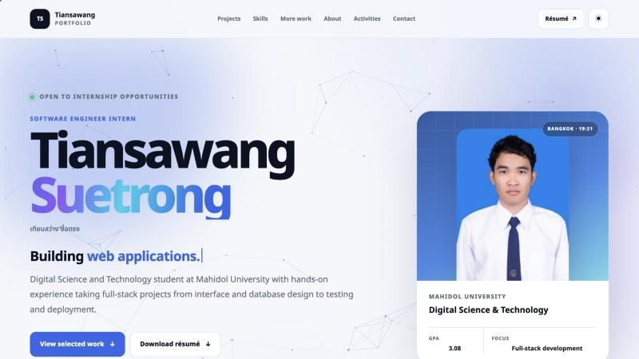

# Tiansawang Suetrong · Internship Portfolio

**Live site → https://tiansawang1818-pixel.github.io/** &nbsp;·&nbsp; **Résumé (PDF) → [resume.pdf](https://tiansawang1818-pixel.github.io/resume.pdf)**



A buildless, responsive portfolio for software engineering internship applications: plain HTML, CSS, and JavaScript served by GitHub Pages, with no framework, build step, backend, or analytics.

## What's inside

| Section | Content |
|---|---|
| Projects | [WasmBot Studio](https://github.com/tiansawang1818-pixel/wasmbot-studio) ([live](https://wasmbot-studio.vercel.app/)) and [HEAT//SHIFT](https://github.com/tiansawang1818-pixel/HEAT) ([live](https://heatshift.hostless.app/)), each with live screenshots, my role, and stack |
| Skills | Programming, frontend, backend and databases, data and geospatial, tools |
| More work | This site, [python-calculator](https://github.com/tiansawang1818-pixel/python-calculator), [HTML101](https://github.com/tiansawang1818-pixel/HTML101) |
| About, activities, contact | Education, university activities, email, GitHub, phone |

## Front-end details

- Light and dark themes with a circular View Transitions wipe; the choice is remembered
- Canvas particle network, aurora background, typing headline, and letter-by-letter name reveal
- Tilt and spotlight cards, magnetic buttons, count-up numbers, scroll progress ring, and a live Bangkok clock
- Custom cursor on fine pointers only
- Every effect is switched off under `prefers-reduced-motion`, and the canvas pauses when it is off screen
- Keyboard-friendly navigation, skip link, semantic landmarks, JSON-LD `Person` data, and a print stylesheet
- A small easter egg for anyone who clicks the logo enough times 🍔

## Project structure

```text
.
├── index.html            all page content
├── css/style.css         theme tokens, layout, effects, print styles
├── js/main.js            theme, animations, and interactions (vanilla JS)
├── assets/images/        favicon, profile photo, live project screenshots, share image
├── resume.pdf            one-page A4 résumé
├── tools/make_resume.py  regenerates resume.pdf
├── robots.txt, sitemap.xml, .nojekyll
```

## Run locally

```sh
python3 -m http.server 4173
```

Then open <http://localhost:4173>.

## Deploy

GitHub Pages publishes the `main` branch root. Push to `main` and the site updates within a minute or two. Asset URLs carry a `?v=` version in `index.html`; bump it when `css/style.css` or `js/main.js` changes so browsers fetch the new files.

## Updating

- **Résumé:** edit the content in `tools/make_resume.py`, then run `python3 tools/make_resume.py resume.pdf` (needs `reportlab`). Keep it to one A4 page and keep the web page in sync.
- **Target role:** search for `EDIT:` in `index.html`.
- **Screenshots:** the WasmBot images were captured from the live app on 11 November 2026 while signed in (the app requires sign-in). The HEAT//SHIFT image was captured from the live City Explorer on 11 November 2026. The share image was captured from this site on 12 November 2026.

Project claims come from the résumé and each project's own source and documentation.
